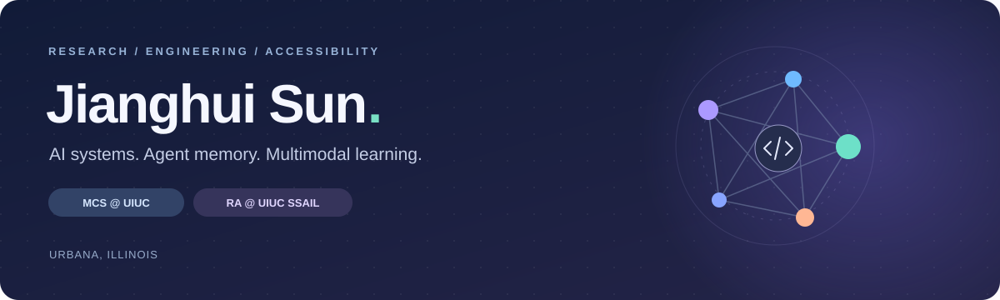

  

  
  &nbsp;
  
  &nbsp;
  

  <b>Exploring how AI systems serve, remember, and understand.</b> 
  MCS student at the University of Illinois Urbana-Champaign. 
  Working across efficient LLM inference, agent memory, and accessible multimodal AI.

## 🟣 Current research

<table>
<tr>
<td width="50%" valign="top">

### LLM inference systems

**UIUC SSAIL · Research Assistant**  
🟢 **Ongoing**

Analyzing prefill/decode-disaggregated LLM serving for multi-turn agent workloads to identify compute bottlenecks and latency trade-offs across repeated inference cycles.

Designing workload-level evaluations of prefill/decode placement, throughput, end-to-end latency, and GPU utilization to inform serving optimization; measurements in progress.

`LLM serving` `P/D disaggregation` `Agentic workloads`

</td>
<td width="50%" valign="top">

### Agent memory evolution

**UIUC · CS546 team research project**  
🟢 **In progress**

Investigating whether **knowledge organization** helps agents learn to revise stale memories while preserving valid information.

`Agent memory` `Reinforcement learning` `Evaluation`

</td>
</tr>
</table>

<b>Inside the CS546 project — research question & evaluation plan</b>

- Developed a controlled evaluation design comparing flat and semantic memory organizations under matched knowledge and feedback budgets to isolate memory-update effects.
- Specified reinforcement-learning-based tests across 3 planned benchmarks (STALE, AgentStream, MemoryAgentBench), measuring stale-memory correction and valid-knowledge retention; experiments ongoing.

## 🔵 Research & engineering experience

### Vision-language understanding

**Research Assistant · Xi’an Jiaotong-Liverpool University** · Nov 2025–Jan 2026

- Built a fine-grained emoji-understanding pipeline integrating DINOv2 visual representations with Qwen-VL language generation to capture subtle expression cues.
- Designed a feature-alignment adapter connecting DINOv2 embeddings to Qwen-VL vision inputs, enabling expression-conditioned descriptions without retraining the full language model.

### Emotion-aware multimodal agents

**Research Assistant · Xi’an Jiaotong-Liverpool University** · Sep–Nov 2025

- Developed a cross-attention soft-prompt adaptation of frozen CLIP for 1,613 emojis across 18 emotion classes; achieved 82.44% Top-1 accuracy and 82.31% macro F1, improving accuracy by 60.91 percentage points over vanilla CLIP.
- Built a VLM/LLM-agent audio-matching workflow with Top-5 retrieval from a 287-clip library; in a 10-person study, improved perceived expressiveness from 2.7/5 to 4.3/5 versus text-only labels.

### Air quality forecasting

**ML Algorithm Engineering Intern · RocKontrol Technology Group** · Jun–Aug 2024

- Built **PyTorch forecasting models on 40k+ records** of air quality, emissions, and meteorological data.
- Compared **RNN, LSTM, GRU, and Transformer** architectures using **24-hour sliding-window histories**.
- Predicted **PM2.5, O3, and AQI** over **6-, 12-, and 24-hour horizons**.

> **~12% lower RMSE** with LSTM versus the baseline RNN, with stable performance across forecast horizons.

## 🟠 Selected builds

| Project | What I built | Focus |
| :--- | :--- | :--- |
| **Cross-modal Audio Generation** Jun–Sep 2025 | Engineered a training-free CLIP/Qwen/FAISS emoji-to-audio retrieval pipeline using Top-5 image matching; organized 1,691 emoji images spanning 18 emotion categories. Curated a 420-clip audio library (279 collected, 141 AI-generated) and integrated AudioLDM2 music with AudioMiniMax speech synthesis into a working accessibility demo. | `Multimodal RAG` `Accessibility` |
| **Daily Reading Tracker** Mar–Jun 2025 | The core reading-log module across the front end and back end of a deployed full-stack Java application, with technical documentation. | `Java` `Full-stack` |

[Explore my portfolio →](https://gary22222222.github.io/cs409-mp0/#projects)

## 🟢 Technical toolkit

**Research toolkit:** CLIP · Multimodal learning · Computer Vision · NLP · LLMs

**Additional tools:** Jupyter · Postman · n8n

View the toolkit as text

- **Languages:** Python, Java, C++, JavaScript, SQL
- **AI / ML:** PyTorch, Transformers, scikit-learn, CLIP, multimodal learning, Computer Vision, NLP, LoRA/PEFT, LLMs, RAG, LangChain
- **Backend & tools:** FastAPI, Spring Boot, REST APIs, Docker, Git, GitHub, Jupyter, Postman, n8n

## 🟣 Publication

**EmoSound: A Multimodal AI Agent Framework for Emotion-Aware Audio Accompaniment of Emoticons**

**Sun, J.**, Shi, H., Yin, Z., Mo, W., Ding, H., Hu, Y., Yang, X., & Yan, Y.

*BICS 2025 conference program* · **Paper #52**

## 🎓 Education

| | Degree | Timeline |
| :--- | :--- | :--- |
| **University of Illinois Urbana-Champaign** | Master of Computer Science | Aug 2026–Expected Dec 2027 |
| **Xi’an Jiaotong-Liverpool University** | B.Sc. in Information and Computing Science **GPA 3.8 / 4.0** | Sep 2022–Jul 2026 |

---

  <b>Let’s connect.</b> 
  LLM systems · Agent memory · Multimodal AI  
  <a href="mailto:jianghuisun69@gmail.com">jianghuisun69@gmail.com</a> &nbsp; / &nbsp;
  <a href="https://gary22222222.github.io/cs409-mp0/">Personal website</a>

